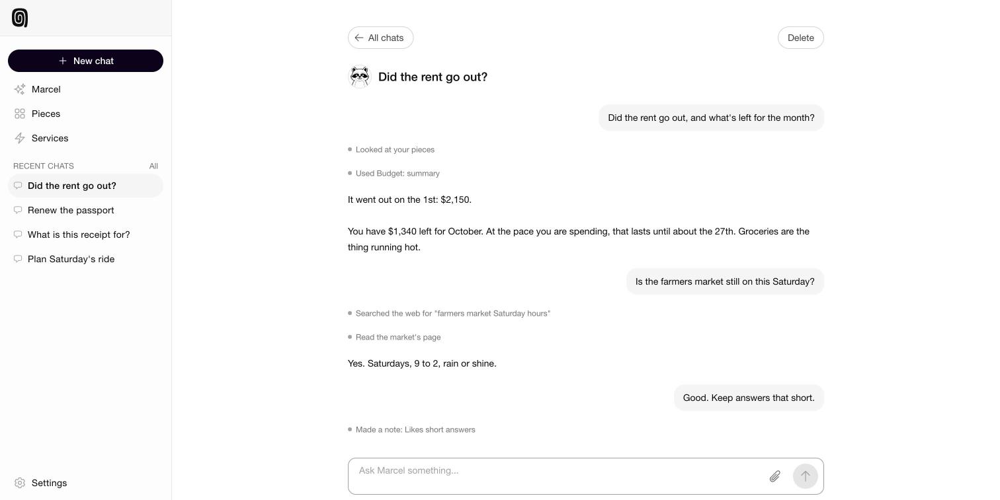

# OpenStudio Personal

Your own agent. Your own software. On your own machine.

<p align="center"></p>

Marcel gets things done for you. He searches the web, reads the pictures you send him, uses the small apps you have built, and remembers how you like things done. It requires only an OpenRouter key to get started. There are no accounts.

## Launch it

### On Railway

<!-- The "Deploy on Railway" button goes here, once the template exists. -->

### On your own machine

```sh
docker run -d --name openstudio --restart unless-stopped \
  -p 127.0.0.1:4010:4010 -p 127.0.0.1:28181:28181 \
  -e OPENSTUDIO_UNSAFE_NO_SECRET=1 -v openstudio:/data \
  ghcr.io/openstudiotech/os-personal
```

Open http://127.0.0.1:4010 and say hello.

## What you need

One key, from [OpenRouter](https://openrouter.ai/settings/keys). Marcel thinks with it and searches with it.

Add a [Steel](https://app.steel.dev/settings/api-keys) key and he can use a browser.

## Build your own pieces

A piece is a small app that does one job your way. Connect Claude Code or Codex under Settings, AI client. Say what you want. It is built and running.

## Know before you run it

- It is not a hardened sandbox. Run pieces you chose.
- It has no accounts, roles or approvals. On your own machine, whoever can use the computer has everything. This is for home use, at your own risk.
- There is no approval step in OpenStudio Personal. Once you grant a piece a service, it can do anything that service allows, such as send mail, delete an event or share a file, without asking you.

## Google

Gmail, Google Calendar and Google Drive sign you in through a Google app of your own. Make it once:

1. In the [Google Cloud console](https://console.cloud.google.com/), create a project and enable the Gmail, Google Calendar and Google Drive APIs.
2. Set up the consent screen, and add yourself as a test user.
3. Create an OAuth client of type "Web application". Give it the redirect address shown on the Services page.
4. On the Services page, press Connect beside Gmail, Google Calendar or Google Drive. The first time, it asks for the client ID and client secret.

Google will say the app is unverified. It is yours, so that is expected.

## Development

Needs Node 22.18 or later and a celld binary at `.dev/celld-v0.6.2-openstudio.1`.

```sh
cd kernel && npm ci
cd ../control && npm ci
npm run kernel     # the kernel, on http://127.0.0.1:28181
npm start          # the control plane, on http://127.0.0.1:4010
```

To test it, with the kernel running:

```sh
cd kernel && CELLS_KERNEL_TEST_URL=http://127.0.0.1:28181 npm test
cd kernel && CELLS_KERNEL_TEST_URL=http://127.0.0.1:28181 node --test --test-force-exit test/scheduler.test.mjs
cd control && npm test
```

Every setting, who can reach it, and running it on Railway by hand are in [docs/running.md](docs/running.md). How pieces are written is in [docs/writing-a-piece.md](docs/writing-a-piece.md).

## Bugs, patches and security

- **A bug:** [open an issue](../../issues/new/choose).
- **A fix:** we do not take pull requests on GitHub. Email a patch to [hi@openstudio.tech](mailto:hi@openstudio.tech) and we will read it. See [CONTRIBUTING.md](CONTRIBUTING.md).
- **A security problem:** email [security@openstudio.tech](mailto:security@openstudio.tech), not an issue. See [SECURITY.md](SECURITY.md).

## Licence

The [Sustainable Use License](LICENSE.md): free for your own use, including inside your own company. Third-party notices are in [THIRD-PARTY.md](THIRD-PARTY.md).
